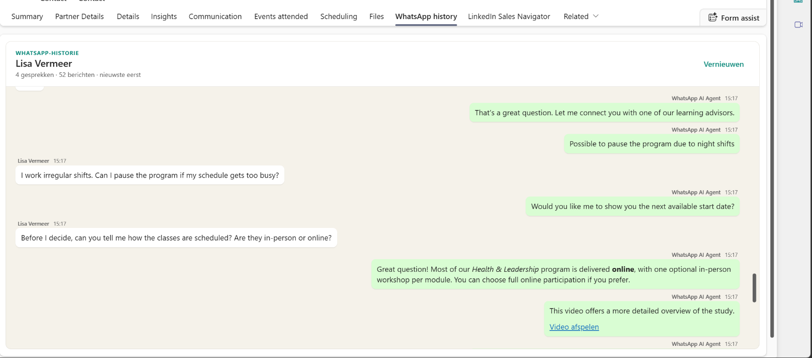

# Dynamics 365 WhatsApp Conversation Viewer

A Power Apps component (PCF) for Dynamics 365 Contact Center that shows all
WhatsApp conversations of a customer as **one continuous thread**.



*A "WhatsApp history" tab on a Contact form in the Copilot Service workspace. The
conversations shown are demo data.*

## The problem

For a customer, WhatsApp is one continuous conversation, even when it runs for
months. In Dynamics 365 Contact Center every contact moment becomes a separate
conversation with its own transcript. A representative who opens a Contact or
Case sees a list of loose sessions and has to open them one by one to piece the
story together.

## What the control does

It combines the WhatsApp conversations of a customer into one thread on the
Contact, Case, and Conversation forms:

- the newest message is at the top, so you see the latest context first
  (switch to oldest first with a setting);
- conversations load page by page while you scroll, so the form stays fast;
- photos, files, adaptive cards, links and emoji are shown as the customer saw
  them (see [Message types](#message-types));
- private notes between representatives are left out;
- it runs with the signed-in user's own permissions. It calls no external
  service and stores no copy of the data.

## Requirements

- Dynamics 365 Contact Center (or Omnichannel for Customer Service) with the
  WhatsApp channel.
- Permission to import solutions in the environment.

## Install

1. Download `WhatsAppConversationViewer_<version>_managed.zip` from the latest
   [release](../../releases).
2. In [make.powerapps.com](https://make.powerapps.com), select the environment,
   then **Solutions** > **Import solution**, choose the file, and import it.
3. Select **Publish all customizations**.

The solution adds the control and three anchor columns, one each on Contact,
Case, and Conversation. It does not change any form: you add the control to the
forms yourself (next section).

To update, import the newer version and choose **Update** (not **Upgrade**), then
publish all customizations. Choosing Upgrade is only safe when you never used a
version older than 1.7.0, because those versions shipped their own form layer.

## Add the control to a form

Repeat this for each form that should show the history. Typical choices are the
**Contact** and **Information** forms of Contact, the **Case** and
**Information** forms of Case, and the **Active Conversation** form of
Conversation.

1. Open the form in the form designer and pick the tab and section for the
   history. A tab of its own works well.
2. Add the anchor column as a **Form field** (see the table below).
3. Select the field, open **Components**, choose **+ Component** > **Unified
   WhatsApp conversation**, and tick **Web**.
4. Set the properties from the table below.
5. On the field, select **Hide label** and set **Form field width** to
   **3 columns**.
6. **Save and publish**, then refresh the form with Ctrl+F5.

| Form | Anchor column | Customer | Entity ID | Entity name |
| --- | --- | --- | --- | --- |
| Contact | `ContactWhatsAppViewerAnchor` | leave empty | bind to the Contact ID column | static value `contact` |
| Case | `CaseWhatsAppViewerAnchor` | bind to **Customer** | leave empty | leave empty |
| Conversation | `ConversationWhatsAppViewerAnchor` | bind to **Customer** | leave empty | leave empty |

The anchor column only hosts the control. It stays empty and stores no data.

### Settings

All of these can stay empty.

| Setting | Purpose | Default |
| --- | --- | --- |
| Sort order | `Newest first` or `Oldest first`, for conversations and for messages | Newest first |
| History in months | How far back to look | 12, maximum 60 |
| Maximum conversations | Maximum number of conversations to list | 50, maximum 100 |
| Conversations per page | Conversations loaded at a time; more load while you scroll | 3, maximum 20 |
| Height in pixels | Fixed height; empty fills the available space of the form | Automatic |
| Show system messages | Include public system messages | Off |

The thread scrolls inside the control. With **Oldest first** the latest message
is at the bottom of the list, after all older conversations.

## Permissions

Representatives need **Read** access to Conversation (`msdyn_ocliveworkitem`),
Transcript (`msdyn_transcript`), Note (`annotation`), and the customer record
(Contact or Account). Dataverse applies those permissions to every request the
control makes. Photos and files are read from Notes.

## Troubleshooting

- **Nothing is shown.** The Customer of the conversation must be the Contact you
  are looking at, the conversation must be on the WhatsApp channel, and it must
  fall inside the history period. A conversation that is still active may not
  have a transcript yet.
- **"Error loading control" in the form designer.** The designer can't run the
  control. Check the form in the app instead.
- **A new setting doesn't show.** Someone may have customized the form in your
  environment. Open **Show layers** on the form and use **Remove active
  customization**.
- **The old version keeps running after an update.** Publish all customizations
  after the import.
- **A photo or file says "niet beschikbaar".** The user probably lacks read
  access to Notes, or the file is no longer stored.

## Message types

| In the transcript | In the control |
| --- | --- |
| Text, emoji, line breaks | Shown as sent. Links are clickable and `*bold*`, `_italic_`, `~strikethrough~` and ` ```monospace``` ` follow WhatsApp formatting. |
| Photos | Shown inline. Click a photo to open it full size in a new tab. |
| Video, audio and voice notes, PDFs and other files | Listed with a button; the file is only downloaded when you click it. Files over 25 MB aren't loaded. If the browser blocks the player, a download link is shown. Files other than photos, video and audio are downloaded with a neutral type, and file names that look executable (`.exe`, `.html`, `.js`, ...) get `.txt` appended. The control doesn't scan files for malware. |
| Adaptive cards | Shown read-only, and only for messages from the bot or a representative, never for what a customer sent. Buttons are labels; only `http` and `https` links work, and the real address is shown next to each link. Images in a card load only after you click them, so opening a conversation doesn't contact third-party servers. |
| Bot cards (hero, thumbnail, video, audio, animation) and suggested replies | Shown read-only as cards. Video and audio are linked, not loaded automatically. |
| Contact Center context events, control messages, private notes | Not shown. |

SVG files are offered as a download and are never displayed inline. The control
reads closed conversation transcripts; the live communication panel remains the
source for the conversation that is still running.

## How it works

The control is a React PCF instead of a standalone web resource, so it uses the
signed-in representative's security context, can be versioned in a solution, and
works in model-driven apps and the Copilot Service workspace.

1. It receives the customer from the form (a lookup, or the Contact itself).
2. It queries `msdyn_ocliveworkitem` by `msdyn_customer`, limited to the history
   period and the WhatsApp channel.
3. It loads the related `msdyn_transcript` and decodes the base64 transcript
   from its annotation, a page of conversations at a time.
4. It parses the public messages and renders one thread, keeping subtle
   boundaries between the technical conversations.

## For developers

### Project structure

- `src/WhatsAppConversationViewer` - React PCF project
- `solutions/WhatsAppConversationViewer` - solution project and unpacked source
- `scripts` - Dataverse helpers for a development environment

### Build

Build outside a OneDrive or other synced folder: `npm` installs example
certificates with `browser-sync` that security scanners flag.

```powershell
Set-Location src\WhatsAppConversationViewer
npm ci
npm run refreshTypes
npm run lint
npm run build

Set-Location ..\..\solutions\WhatsAppConversationViewer
dotnet build -c Release
```

### Deploy to a development environment

Confirm the active Power Platform environment before you deploy:

```powershell
pac org who
Set-Location solutions\WhatsAppConversationViewer
dotnet build -c Release
pac solution import --path bin\Release\WhatsAppConversationViewerSolution.zip --force-overwrite --publish-changes --async --max-async-wait-time 40
```

Always import with `--publish-changes`. Without publishing, Dataverse keeps the
previous bundle even though the solution version increased. Raise the control
version in `ControlManifest.Input.xml` and the solution version for every change,
then check the deployed `customcontrol.version`.

The Python scripts in `scripts` need `pip install PowerPlatform-Dataverse-Client
azure-identity requests` and a `.env` file next to them (ignored by Git):

```text
DATAVERSE_URL=https://yourorg.crm.dynamics.com
TENANT_ID=<tenant id>
SOLUTION_NAME=WhatsAppConversationViewer
PUBLISHER_ID=<publisher guid>
```

To try the control quickly in a development environment, the script
`configure_whatsapp_viewer_forms.py` adds a **WhatsApp history** tab with the
control to the five standard forms of Contact, Case, and Conversation, using the
settings in the table above. `verify_deployment.py` checks the result.

### Build the package to share

The package for other environments contains the control and the three anchor
columns, and no forms. Forms exported from a development environment carry
fields, scripts, and dependencies of every app installed there, and importing
them fails in an environment without the same apps.

Build it from a managed export, so the platform computes the package:

```powershell
# 1. Export the managed solution and unpack it into a temporary folder
pac solution export --name WhatsAppConversationViewer --path temp\export_managed.zip --managed true
pac solution unpack --zipfile temp\export_managed.zip --folder temp\managed-src --packagetype Managed

# 2. Remove the forms, and raise <Version> in temp\managed-src\Other\Solution.xml
python scripts\prepare_core_package.py temp\managed-src

# 3. Pack the package to share
pac solution pack --zipfile WhatsAppConversationViewer_<version>_managed.zip --folder temp\managed-src --packagetype Managed
```

`pac solution pack` refuses to build a managed package from the unmanaged source
in the repository, which is why the package comes from a managed export. After
unpacking an unmanaged export into `solutions\WhatsAppConversationViewer\src`,
run `python scripts\prepare_core_package.py` without arguments so the repository
source stays free of forms too.

If your development environment has fields or web resources of your own in the
solution, list them in `scripts\foreign_components.local.json` (start from
`foreign_components.example.json`, the file is ignored by Git) and run
`python scripts\strip_foreign_components.py <folder>` on the unpacked source as
well.

## Known considerations

- Dynamics 365 stores separate Contact Center conversations even though the
  customer's WhatsApp client displays one continuous thread.
- Transcript JSON can vary by channel provider and platform release. The parser
  supports the common `messages`, `activities`, `value`, `transcript`, and
  `items` shapes.
- Keep a WhatsApp Business-Scoped User ID linked through the Dynamics Social
  Profile, so future conversations resolve to the same Contact.
- Photos from live chat were tested with real data. Video and voice notes were
  only tried with test files, and a browser or security policy that blocks
  `blob:` media falls back to a download link.

## Disclaimer

This is an independent, community project. It is not affiliated with, endorsed
by, or supported by Microsoft Corporation or Meta Platforms, Inc.

WhatsApp is a trademark of Meta Platforms, Inc. Microsoft, Dynamics 365,
Dataverse, Power Apps, and Copilot Studio are trademarks of Microsoft
Corporation. The names are used only to describe what the control works with.

The software is provided as is, without warranty. Test it in a non-production
environment first.

## License

[MIT](LICENSE). Third-party notices are in
[THIRD_PARTY_NOTICES.md](THIRD_PARTY_NOTICES.md). See also
[CONTRIBUTING.md](CONTRIBUTING.md) and [SECURITY.md](SECURITY.md).
